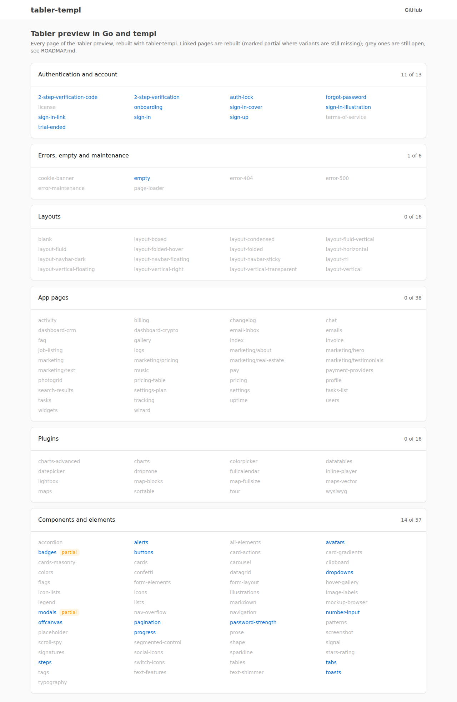
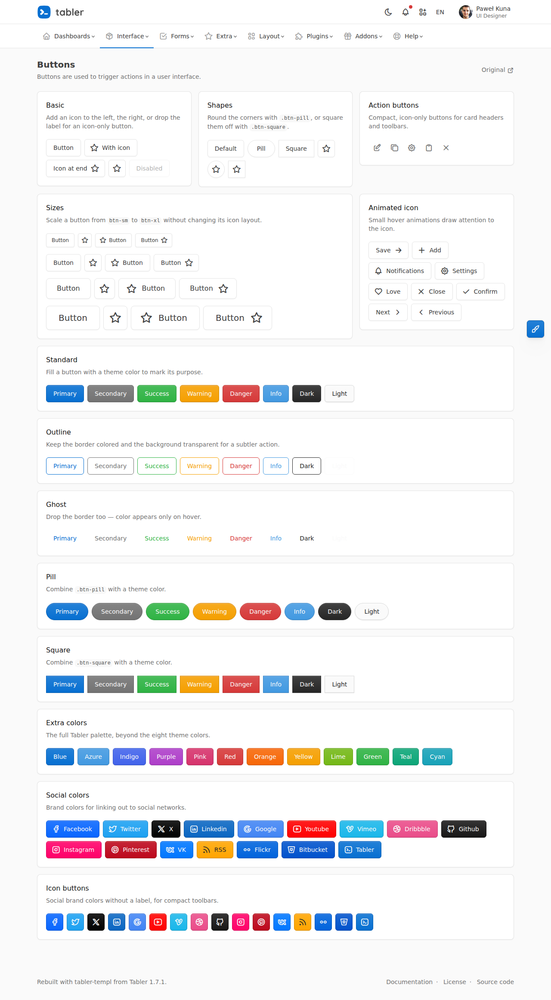
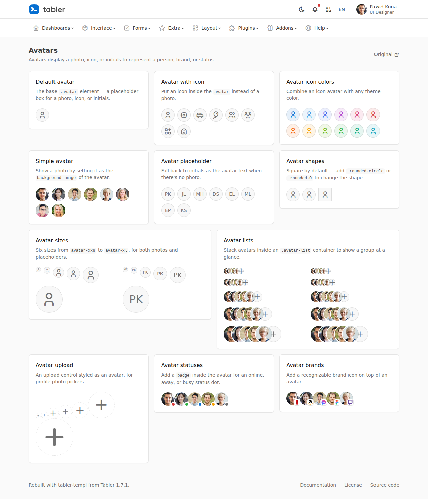
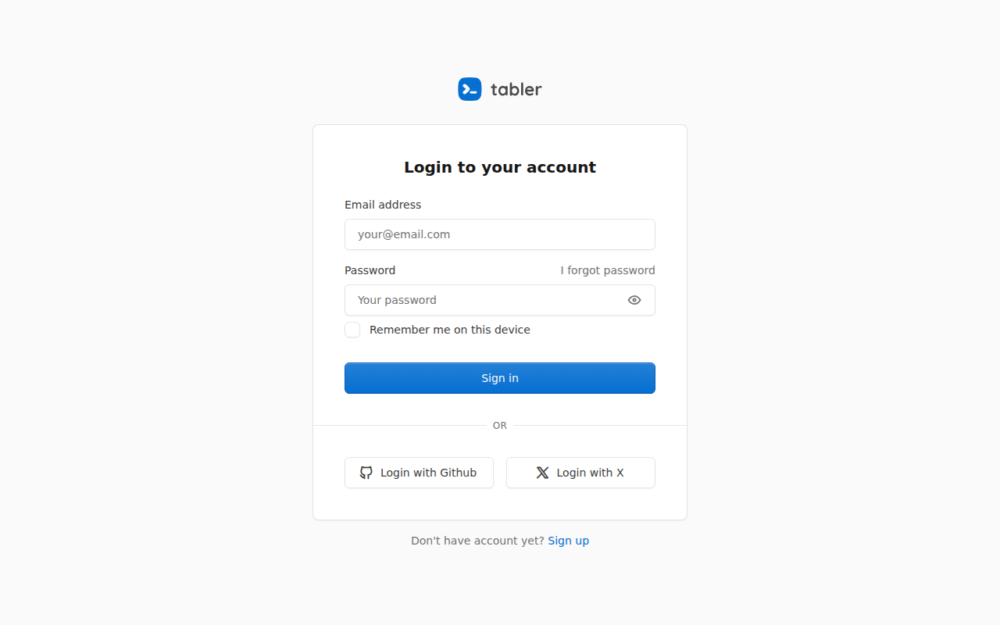
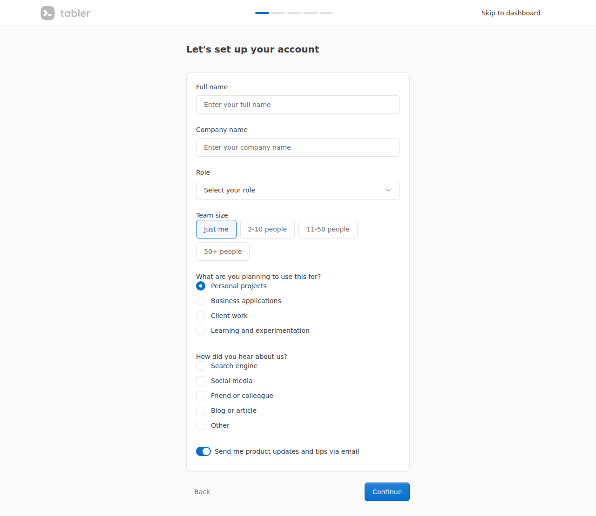

# tabler-templ

**[Tabler](https://tabler.io) for Go and [templ](https://templ.guide).** Server-rendered components, composed
blocks and whole pages with Tabler's own classes and markup, so an admin or back-office app in Go gets the
Tabler look without a frontend toolchain.

> Formerly `github.com/mind-vm/tablerkit`. The repository was renamed; the module path is now
> `github.com/mind-vm/tabler-templ` from v0.8.0 on. Replace the import path in your code and `go.mod`
> (GitHub redirects the old repository, but Go modules need the new path).



## Why

There are good component libraries for templ, modelled after [shadcn/ui](https://ui.shadcn.com) and built
on Tailwind ([shadcn-templ](https://github.com/axadrn/shadcn-templ) and others). There was none for Tabler.
tabler-templ differs from them in three ways:

- **No Node, no Tailwind, no build step.** Go, templ and Tabler's ready-made CSS and JS (from a CDN or
  embedded in your binary). One binary.
- **Whole pages, not only building blocks.** The goal is all of Tabler: every component of the Tabler docs,
  every composed part of the Tabler preview (sign-in cards, modals, navbars …) as a block, and every page of
  the [preview](https://preview.tabler.io) rebuilt in Go.
- **Tabler's markup, unchanged.** Classes and structure follow the Tabler docs and its Astro sources, so the
  Tabler docs (and the agents that read them) apply as they are.

The API follows shadcn-templ: one package per component, a `Props` struct, `Class` and `Attributes` on every
component, children via `{ children... }`. Except for the sidebar and the detail dialogs the module has no
JavaScript of its own: components emit Tabler's classes and `data-bs-*` attributes, and Tabler's bundled
script does the rest (modals, dropdowns, dismissible alerts).

## Status

Early (v0.x); the API may still change between minor versions until v1, breaking changes are listed in
[CHANGELOG.md](CHANGELOG.md). Today the module has the components and blocks the apps using it needed;
[ROADMAP.md](ROADMAP.md) is the checklist of everything in Tabler, with the status of each component, block
and preview page. Next steps, one pull request each:

1. Navigation and overlays: dropdown, tabs, nav, breadcrumb, offcanvas, toast, tooltip, popover
2. Showing data: avatar, list group, timeline, datagrid, progress, steps, status, ribbon, empty, tracking
3. Forms: input group, select group, image check, color check, OTP, password strength, validation, floating labels
4. Sign-in and account blocks: sign-in variants, sign-up, forgot password, 2FA, auth lock, onboarding
5. Blocks from Tabler's cards, modals and navbars, and the app pages: settings, profile, pricing, invoice, error pages, wizard; the layouts
6. The remaining preview pages in the demo, with screenshots here
7. A starter kit (`cmd/new`) that creates a running app with layout, sign-in and a list page

```sh
go get github.com/mind-vm/tabler-templ@latest
```

## Demo

`cmd/demo` rebuilds the Tabler preview page by page with this module. Its index lists all 146 preview pages;
rebuilt ones are linked, open ones grey.

```sh
go run ./cmd/demo -addr localhost:8080
```

| Buttons | Avatars |
|---|---|
|  |  |
| **Sign in** | **Onboarding** |
|  |  |

`scripts/screenshots.sh` takes the screenshots in `docs/screenshots/` with Playwright (the only place that
uses Node; set `CHROMIUM` to use an installed Chromium). `scripts/screenshots/compare.mjs` puts a rebuilt page
next to the Tabler original to check it by eye.

## Use

```go
import (
	"github.com/mind-vm/tabler-templ/button"
	"github.com/mind-vm/tabler-templ/card"
	"github.com/mind-vm/tabler-templ/modal"
)

templ Customer(c Customer) {
	@card.Card(card.Props{Section: true}) {
		@card.Header() {
			@card.Title() { Customer }
			@card.Actions() {
				@button.Button(button.Props{Size: button.SizeSmall, Icon: "ti-pencil", Type: "button",
					Attributes: modal.Trigger("edit-customer")}) { Edit }
			}
		}
		@card.Body() { { c.Name } }
	}
	@modal.Modal(modal.Props{ID: "edit-customer", Title: "Customer", Centered: true, Fade: true}) {
		…form…
	}
}
```

The page must load Tabler's CSS and JS (`@tabler/core`) and, for icons, the Tabler icons webfont plus `icon.Styles()`
(the blocks' pages include it). The kit
does not ship or link them: serve them yourself (embedded in your binary or from a CDN, as you prefer).

## Components

| Package | Components |
|---|---|
| `button` | `Button` (`<button>` or `<a>` with `Href`), colors, outline, ghost, pill, square, sizes up to xl, icon at start or end, icon-only, action, block, loading, animated icons, floating; `List`, `Actions`, `Group` (button groups), `Check` (radio or checkbox as a button); `Classes(p)` |
| `card` | `Card` (sizes, link with hover effect, borderless, dashed, transparent, stacked, active, inactive, status line), `Header` (light), `Title`, `Subtitle`, `Actions`, `Body` (scrollable), `Footer` (transparent), `Stamp`, `Progress`, `Image` |
| `modal` | `Modal` (sizes, centered, scrollable, custom header, footer, `<form>` as content); `Trigger(id)` attributes for any button |
| `form` | `Field` (label, required, description, help popover, hint, error, valid feedback), `Input` (sizes, rounded, flush, plaintext, color, datalist, validation incl. lite), `Select` (groups, multiple, sizes), `Textarea` (autosize), `Check` (checkbox, radio, switch, large, inline, on/off labels), `Group`/`Addon`/`AddonLink` (input groups), `InputIcon`, `PasswordToggle` + `PasswordToggleScript`, `SelectGroup`/`SelectItem` (pills, boxes), `ImageCheck`, `ColorCheck`, `Floating`, `Fieldset`, `Range`, `NumberInput`, `OTP`, `Strength`, `Footer`, `Text` |
| `table` | `Table` (optionally responsive, wrapper classes), `Empty` row |
| `pagination` | `Pagination` with first/last/neighbour pages, arrows or text labels, first/last links, named previous/next pages; `Numbers(page, pages)` |
| `alert` | `Alert` (variant with its default icon, heading and description, important, minor, dismissible), `Action`, `Link`, `List` |
| `badge` | `Badge` (color, light, outline, sizes, pill, icons, icon-only, dot, notification, blink), `List` |
| `dropdown` | `Dropdown` (direction), `Toggle` (any `button.Props`), `ToggleAttributes`, `Menu` (end, arrow, dark, card, scrollable), `Item` (link or button, icon, active, disabled), `Text`, `Check` (checkbox, radio, switch), `Header`, `Divider`, `Columns`/`Column`, `Submenu` |
| `nav` | `Nav` (tabs, pills, underline, bordered, vertical, fill, justified, sizes, in a card header, overflow into a "More" menu), `Item` (link or tab for a `Pane`, icon, active, disabled), `Dropdown`, `Content`, `Pane`; `Segmented`/`Segment` (segmented control as tabs or radio buttons) |
| `breadcrumb` | `Breadcrumb` (separators, muted, icon crumbs) |
| `offcanvas` | `Offcanvas` (placement, responsive, floating, narrow, title/header, footer, scroll, backdrop), `Trigger(id)`, `Dismiss()` |
| `toast` | `Toast` (header with avatar, title and time, colors, autohide, urgent), `Container` (screen position), `Trigger(id)`, `Dismiss()` |
| `tooltip` | `Attrs(title, placement)`, `HTML(…)`: attributes for any element |
| `popover` | `Attrs(Props)`: title, content, placement, trigger, container, HTML |
| `avatar` | `Avatar` (photo, initials, icon, link, sizes xxs–2xl, shapes, color, status, brand, cover), `List` (stacked, sizes), `Upload` |
| `flag` | `Flag("de")` with sizes (needs Tabler's `tabler-flags.css`) |
| `listgroup` | `List` (sizes, flush, hoverable, selectable, transparent, horizontal, numbered, in a card), `Item` (div, link, button, label or li; media, title, description, meta and actions slots; active, disabled, colors), `Header`, `Nested` with `CollapseToggle` and `ToggleIcon`, `SelectCheck` |
| `progress` | `Progress` (value, color, sizes, shown value, indeterminate, striped, animated), `Multi`, `Stacked`, `Background`, `Description`, `Steps` |
| `steps` | `Steps(Props, []Step)`: titles, numbers (counter), descriptions (vertical), colors, tooltips, or dots with read-out labels |
| `status` | `Status` (color, dot, animated, lite), `Dot`, `Indicator` |
| `timeline` | `Timeline` (simple), `Event` (icon or avatar marker, color, time, title) |
| `datagrid` | `Grid` (horizontal, columns, item and title width, gap, as `<dl>`), `Item` |
| `empty` | `Empty` (icon, illustration or big header text, title, subtitle, action) |
| `ribbon` | `Ribbon` (top, bottom, start, end, bookmark, color, text or icon) |
| `tracking` | `Tracking(Props, []Block)`: colored blocks with tooltips, squares |
| `divider` | `Text`: rule with a label ("or"), start/end, colors |
| `iconlist` | `List` (inline, marker color, size, row gap), `Item` (icon, color) |
| `sidebar` | `Sidebar` (fixed left, collapsible to icons, a sheet on small screens), `Header`, `Brand`, `Content`, `Group`, `Item` (icon, active, count badge), `Separator`, `Footer`, `User` (dropdown), `Trigger` (menu and collapse buttons for the page header), `Styles`, `Script`, `Collapsed(r)` |
| `icon` | `Icon("ti-…")` with Tabler's `.icon` sizing, sizes, color, inline – full class name, so icon-font subsetters can find it in the source; `Styles()` sizes webfont icons where Tabler's CSS only sizes SVG (avatars, stamps, empty states) |
| `kit` | `Classes`, `If`, `Attrs`, `Default`, `Messages` |

Everything else in Tabler is listed in [ROADMAP.md](ROADMAP.md).

## Blocks

Components are small and know nothing about the app. Blocks are bigger pieces built from them, the
way [shadcn/ui](https://ui.shadcn.com/blocks) separates the two: a whole page frame or a whole list
page, so a new app starts with the parts every app needs. Like components they are packages with
props; what differs per app goes into slots (`templ.Component` props) or the children.

| Package | Block |
|---|---|
| `blocks/shell` | `Page`: the HTML document with sidebar, sticky header (sidebar buttons, breadcrumbs, actions), page header (heading, extra, subtitle, actions), flash message and content; `Header`, `Breadcrumbs`, `PageHeader`, `Styles` for own frames |
| `blocks/listpage` | `New(r, Config, filters…)` reads search, filters and page from the URL; `Paginate` cuts out a page (25 rows); `Card` = `Search` (search field, filter selects, Reset) + children + `Footer` ("1–25 of 80" and page numbers) |
| `blocks/detail` | `Section` (card with title, extra and at most one action), `Actions`, `EditButton`, `Fields`/`Field`; `Dialog` (a section's edit dialog: context line, error, `Section` hint, `Large` for lists) and `Script(ScriptConfig)`: hidden fields in its forms, footer with Cancel, focus, reopening with error and values after a failed save, reopening a large dialog after saving a row, values from the opening button; `window.kitDialog.open/matchForm` |
| `blocks/create` | `Form` (post form of a create page) and `Footer` (hint, Cancel back to the list, primary Create button): creating is a page of its own, not a dialog |
| `blocks/history` | `Timeline([]Entry)`: when, who, what and the changed fields, newest first; the app phrases the text |
| `blocks/signin` | `Page` (centered sign-in page without sidebar: brand, heading, intro, flash, footer), `Password` (user name and password with the browser's autocomplete names, error, "stay signed in", hidden fields) and `Picker` (accounts to choose, e.g. for demos); credentials and sessions stay in the app |
| `blocks/auth` | Tabler's sign-in and account pages: `Page` (centered, optional illustration `Aside`), `CoverPage` (form beside a cover image), `OnboardingPage` (top bar with progress); `SignInForm`, `SignInCard` (other providers), `SignUpCard` (password strength, terms), `ForgotPasswordCard`, `LockCard`, `VerifyCard` (OTP code), `FormCard` (own fields), `Card`, `Message`, `Note`, `Logo`. All texts are props (Tabler's English by default) |
| `blocks/landing` | `Page` (public start page without sidebar: top bar with brand, anchor links and actions, footer slot), `Hero` (title, lead, actions, optional visual), `Section` (full-width band with heading, `Muted` to set it apart), `Features` (icon, title, text in a grid), `Steps` (numbered), `CallToAction`, `Footer` (text and links); no script |
| `blocks/tabscard` | `Card(Props, []Tab)`: the tabbed card of the preview (tabs in the header, one panel each; icons, end tab, disabled, fill, reverse, fade, a dropdown tab) |
| `blocks/stats` | `Row([]Stat)` and `Tile`: key figures in a strip (label with optional marker, value, small extra, link to act on it) |

```go
func customers(w http.ResponseWriter, r *http.Request) {
	l := listpage.New(r, listpage.Config{Placeholder: "Name, city …"})
	rows := listpage.Paginate(l, allCustomers(), func(c Customer) bool { return listpage.Contains(l.Query, c.Name, c.City) })
	customersPage(r, l, rows).Render(r.Context(), w)
}

templ customersPage(r *http.Request, l *listpage.List, rows []Customer) {
	@shell.Page(shell.Props{Title: "Customers", AppName: "Acme", Head: head(), Scripts: scripts(),
		Sidebar: nav(r), Collapsed: sidebar.Collapsed(r), Breadcrumbs: []shell.Crumb{{Text: "Customers"}}}) {
		@listpage.Card(l) {
			@table.Table() { … rows … }
		}
	}
}
```

`shell.Page` renders the kit's CSS before `Head`, so the app's theme overrides it, and the sidebar
script after `Scripts`. Texts come from `kit.Messages` (Search, Reset, "of", Breadcrumbs, Edit, Cancel, Create, NoEntries, SignIn, Username, Password …).

The detail script is the kit's second script (after the sidebar's). The server and the script exchange
the dialog's state after a failed save: the page sets a global variable (default `kitDialogState`) to
`{"id": …, "error": …, "values": {field: [values]}}`, and the forms carry hidden fields with the dialog's
ID and the page to return to. `ScriptConfig` renames all of them for apps that already have their own.

### A section with its own navigation

An area like "Settings" or "Master data" with its own menu needs no block: render the sidebar with a
back link and the area's group while one of its pages is open.

```go
templ nav(current string) {
	@sidebar.Sidebar(sidebar.Props{ID: "sidebar"}) {
		@sidebar.Content() {
			if inSettings(current) {
				@sidebar.Group(sidebar.GroupProps{}) {
					@sidebar.Item(sidebar.ItemProps{Href: "/", Icon: "ti-arrow-left", Label: "Back"})
				}
				@sidebar.Group(sidebar.GroupProps{Label: "Settings"}) {
					@sidebar.Item(sidebar.ItemProps{Href: "/settings/users", Icon: "ti-users", Label: "Users", Active: current == "users"})
				}
			} else {
				@sidebar.Group(sidebar.GroupProps{Label: "Work"}) { … }
				@sidebar.Group(sidebar.GroupProps{End: true}) {
					@sidebar.Item(sidebar.ItemProps{Href: "/settings/users", Icon: "ti-settings", Label: "Settings", Trailing: "ti-chevron-right"})
				}
			}
		}
	}
}
```

### Sidebar

Tabler has no sidebar that collapses to icons, so `sidebar` is the one package with CSS and script of its
own: render `@sidebar.Styles()` in `<head>` and `@sidebar.Script()` after Tabler's script. On large screens
the sidebar is fixed on the left and the `Trigger` collapses it to icons (items show their label as a
tooltip then); the script remembers the choice in the cookie `kit_sidebar`, and `sidebar.Collapsed(r)`
reads it so the server renders the same state. On small screens the sidebar is Tabler's offcanvas
(`offcanvas-lg`), opened by the menu button of the `Trigger`. Theme it with the CSS variables listed in
`sidebar/sidebar.go` (`--kit-sidebar-width`, `--kit-sidebar-bg`, …). The page's `.page-wrapper` must be the
sidebar's next sibling:

```go
templ Layout(r *http.Request) {
	<div class="page">
		@sidebar.Sidebar(sidebar.Props{ID: "sidebar", Collapsed: sidebar.Collapsed(r)}) {
			@sidebar.Header() {
				@sidebar.Brand(sidebar.BrandProps{Href: "/", Title: "Acme"})
			}
			@sidebar.Content() {
				@sidebar.Group(sidebar.GroupProps{Label: "Work"}) {
					@sidebar.Item(sidebar.ItemProps{Href: "/customers", Icon: "ti-building", Label: "Customers", Active: true})
				}
			}
			@sidebar.Footer() {
				@sidebar.User(sidebar.UserProps{Initials: "AA", Name: "Ann Example"}) {
					<a class="dropdown-item" href="/logout">Log out</a>
				}
			}
		}
		<div class="page-wrapper">
			<header>@sidebar.Trigger(sidebar.TriggerProps{Target: "sidebar", Collapsed: sidebar.Collapsed(r)})</header>
			…
		</div>
	</div>
}
```

## Conventions

- Every component takes `Class` (appended) and `Attributes` (spread last; an attribute you pass wins over a
  default, e.g. `title`, `id`, `type`).
- Components with only optional props take `...Props`, so `@card.Body()` works; components with a required
  prop (`modal.Modal`, `pagination.Pagination`, form controls) take `Props`.
- templ keeps one space where the source has a line break between text and an element or `if` (HTML
  whitespace normalisation; there is no `{{- -}}`-style trim, see a-h/templ#1205). Where that matters
  (punctuation), put the punctuation right after the element on the same line, build the sentence in
  Go, or write an intended space as `{ " " }`.
- Generated `*_templ.go` files are committed, so the module works with a plain `go get`.

## Theming

The kit never hardcodes colors, radii or fonts. All appearance comes from CSS:

1. **Tabler's custom properties.** Override `--tblr-primary`, `--tblr-border-radius`, `--tblr-body-bg`,
   `--tblr-font-sans-serif` … in your own stylesheet loaded after Tabler. This restyles every component.
2. **Dark mode.** Tabler's `data-bs-theme="dark"` on `<html>` or any container.
3. **Your own classes.** `Class` on any component (e.g. `card.Card(card.Props{Class: "island"})`) for app
   specific looks, styled in your CSS.

## Texts and languages

The kit renders only a few texts itself (aria-labels such as "Close", "Previous page"). Set them once per
request; props still override them per call:

```go
ctx = kit.WithMessages(r.Context(), kit.German) // or your own kit.Messages{…}
```

There are no translation files in the kit. An app with several languages picks the `Messages` for the
request's language (and translates its own texts with whatever it uses, e.g. go-i18n).

## Develop

```sh
go tool templ generate             # after editing .templ files (templ is a Go tool dependency)
go run ./internal/catalog/roadmap  # after changing a status in internal/catalog
go test ./...
```

`internal/catalog` holds the checklist (every Tabler component, block and preview page with its status);
ROADMAP.md and the demo index are generated from it, and a test fails when either is out of step. Markup
and classes come from Tabler's sources (`shared/ui/*.astro`, `shared/components/**`, `docs/content/ui/**`
in [tabler/tabler](https://github.com/tabler/tabler)); nothing is invented.

## License

MIT, see [LICENSE](LICENSE). Tabler and the Tabler icons (also MIT) are not part of this module. tabler-templ is not an official Tabler project.
