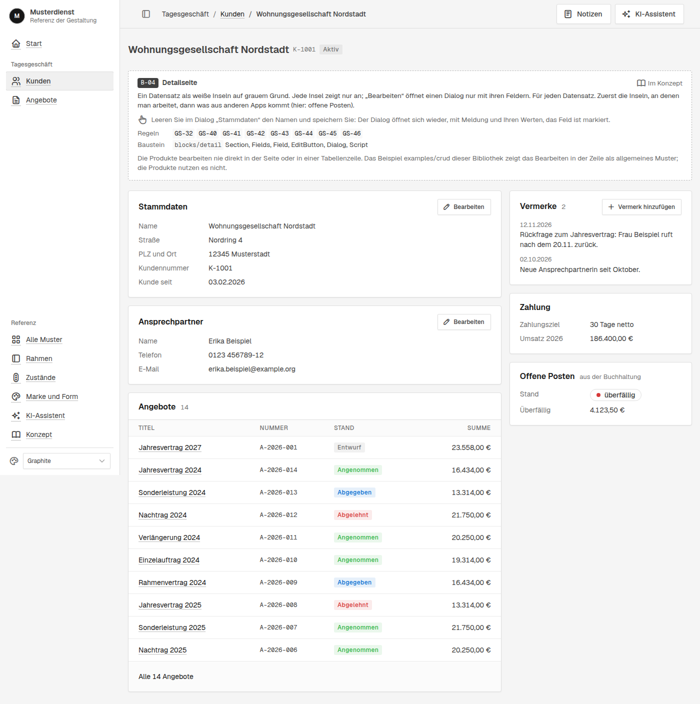
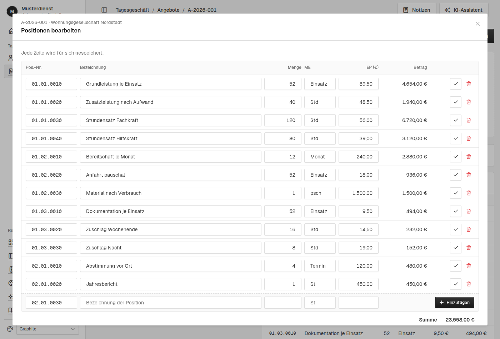
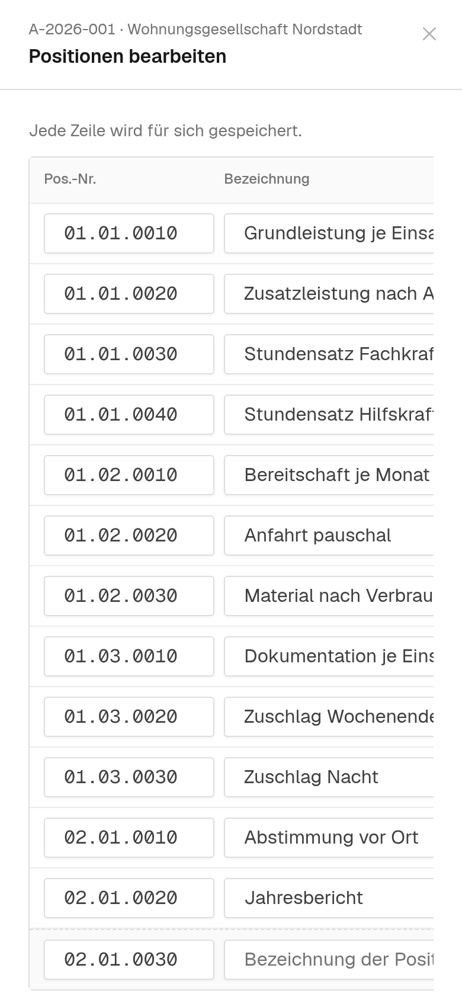

# Reference app of the design concept „Gestaltung“

A living reference of the office UI patterns that the products built on tabler-templ share (Auftragsbutler,
Buchhalter, Support, Vergabe …). Every pattern of the concept
[Gestaltung](https://github.com/mind-vm/auftragsbutler/blob/main/docs/konzepte/gestaltung.md) (rules GS-01 to
GS-75, §11 „Beispiele“) is a page here, built from the real blocks of this module. It is not a mockup: when a block
changes, the page changes with it, and the tests and screenshots notice.

The concept is the source of truth (GS-03). The pages show the rules; they do not restate them. Each page starts with
a short German text: what the pattern is, when to use it, the rule numbers, the block that implements it, and a link
to the concept. Pages and sample data are German like the products (GSO-02); the code is English like the module.



## Run

```sh
go run ./cmd/demo -addr localhost:8080   # then open http://localhost:8080/reference
```

`cmd/demo` mounts it at `/reference`. To run it on its own:

```go
mux := http.NewServeMux()
reference.Register(mux)
http.ListenAndServe("localhost:8080", http.NewCrossOriginProtection().Handler(mux))
```

Saving writes to a store in the process, so messages, errors in dialogs and editing the list really run; „Beispieldaten
zurücksetzen“ on the overview puts the sample data back. Today is fixed at 15.11.2026, so the pages stay the same.

Nothing loads from a CDN (GS-09): Tabler 1.7.3, a subset of the icon webfont (`cmd/static`), the filled icons' font and
the Geist fonts (`cmd/vendor theme:graphite`) are embedded under `static/` and served by package `static`. The theme is
`themes.Graphite`, applied to `:root` as `libs/rahmen` does; `static/reference.css` holds what no theme covers (grey
ground, signal colours, content width, links, numbers, 16 px fields on phones) — the counterpart of the products'
`theme.css`. After using a new icon, run `go run ./cmd/static -out examples/reference/static ./examples/reference/...`.

## The concept inside the app

`/reference/konzept` shows the concept Gestaltung and `/reference/konzept/assistent` the concept Assistent, rendered
from their Markdown with package `markdown`. The links go both ways. The rule numbers in a page's explanation lead to
the rule's row in the concept (`#gs-41`), and „Im Konzept“ leads to its section. In the concept, every example
(B-01 …) and every rule a page shows (GS-41, KA-20 …) links to that page. Headings get GitHub's anchors. Links to
other documents lead to GitHub at the commit of the copy.

The concept lives in mind-vm/auftragsbutler until v1.0 (GSO-01) and stays the source of truth (GS-03).
`konzept/` holds a copy with its commit in `konzept/QUELLE`, and each concept page says so. After the concept
changes, `scripts/reference-konzept.sh` copies it again (it needs `gh`). `TestConceptLinksBothWays` fails when a
heading or rule that a page links to is gone.

## Themes

The picker at the foot of the sidebar switches the whole reference between every theme of `themes` (GS-15). Graphite
is the default, as in the products. The browser remembers the choice, and `?theme=midnight` sets it too. The fonts of
all themes are in the bundle.

## Pages and rules

| Page | Path | Shows | Rules | Blocks |
|---|---|---|---|---|
| Overview | `/reference` | all patterns with one sentence each | | |
| Konzept | `/reference/konzept`, `/reference/konzept/assistent` | the concepts Gestaltung and Assistent, linked both ways | | `markdown` |
| **B-01** Rahmen | `/reference/rahmen` | header, grouped sidebar, content, panel on the right with tabs; menu and sheet on phones | GS-10 – GS-15, GS-20 – GS-22 | `blocks/shell`, `sidebar`, `blocks/sidepanel`, `themes` |
| **B-02** Start | `/reference/start` | figures that lead to filtered lists, the list „Brennt“ | GS-30 | `blocks/metric`, `table` |
| **B-03** Liste | `/reference/kunden` | search (ä = ae), one filter, 25 rows, pages, pills, traffic light, numbers right, state in the URL | GS-31, GS-50 – GS-54 | `blocks/listpage`, `table`, `status`, `badge` |
| **B-04** Detailseite | `/reference/kunden/K-1001` | islands with one Edit each, dialogs, error in the dialog, addition (note), sub-list with „Alle N“ | GS-32, GS-40 – GS-46 | `blocks/detail` |
| **B-05** Liste bearbeiten | `/reference/angebote/A-2026-001` | the full-page dialog: save a row (Enter), delete after a question, new row with the next number, total; read-only after submitting (`A-2026-002`) | GS-55 – GS-59 | `blocks/rowedit` (new), `blocks/detail` |
| **B-06** Anlegen | `/reference/kunden/neu` | a page of its own with few fields, then the detail page with a message | GS-33, GS-60 | `blocks/create` |
| **B-07** Zustände | `/reference/zustaende` | message with next step, empty state, empty search, error pages in the frame, read-only, placeholder while loading | GS-60 – GS-64 | `blocks/shell` (`Flash.Next`), `empty`, `alert`, `placeholder` |
| **B-08** Marke und Form | `/reference/marke` | tokens, signal colours, font, buttons, pills, traffic light, number and date formats, links | GS-07, GS-15, GS-70 – GS-75 | `themes`, `button`, `badge`, `status` |
| **B-09** KI-Assistent | `/reference/assistent` | the assistant as a tab of the panel: reads, fills in forms, never saves; bank details refused | GS-13, KA-01 – KA-03, KA-15, KA-20 | `blocks/sidepanel`, `blocks/assistant` |

B-09 is a proposal: the concept Gestaltung does not list the assistant among its examples yet; its rules (KA-xx) stand in
the concept [Assistent](https://github.com/mind-vm/auftragsbutler/blob/main/docs/konzepte/assistent.md) §6. The
assistant here is a fixed script, not a language model; what it asks to do goes through `assistant.Catalog` as a
model's requests would.

`examples/crud` stays as it is (GSO-04): it shows editing in a table row as a general pattern of the library. The
products do not edit in the page or in a row (GS-45); the pages B-04 and B-05 say so.

## Tests

`reference_test.go` checks every rule that can be checked on the server; each test carries the rule's number in its
name (GSO-05), e.g. `TestGS41_IslandHasAtMostOneAction`, `TestGS45_NoDrawersNoFieldsInIslands`,
`TestGS71_NoRuleNumbersOutsideTheExplanation`, `TestGS09_NothingFromOutside`. The blocks have their own tests
(`blocks/rowedit`, `blocks/sidepanel`).

GS-14 (no page scrolls sideways) needs a browser: `scripts/reference.sh` starts the demo and runs
`scripts/screenshots/reference.mjs`, which takes every page with its dialogs and the panel at the desktop (1400 × 950)
and on a phone (390 × 844) into `docs/screenshots/reference/`, and fails when a page scrolls sideways, logs an error or
loads anything from outside.

| Desktop | Phone |
|---|---|
|  |  |
